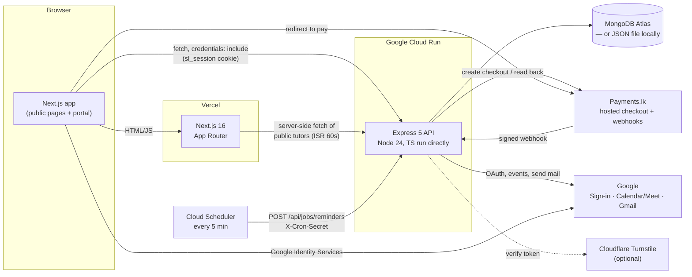
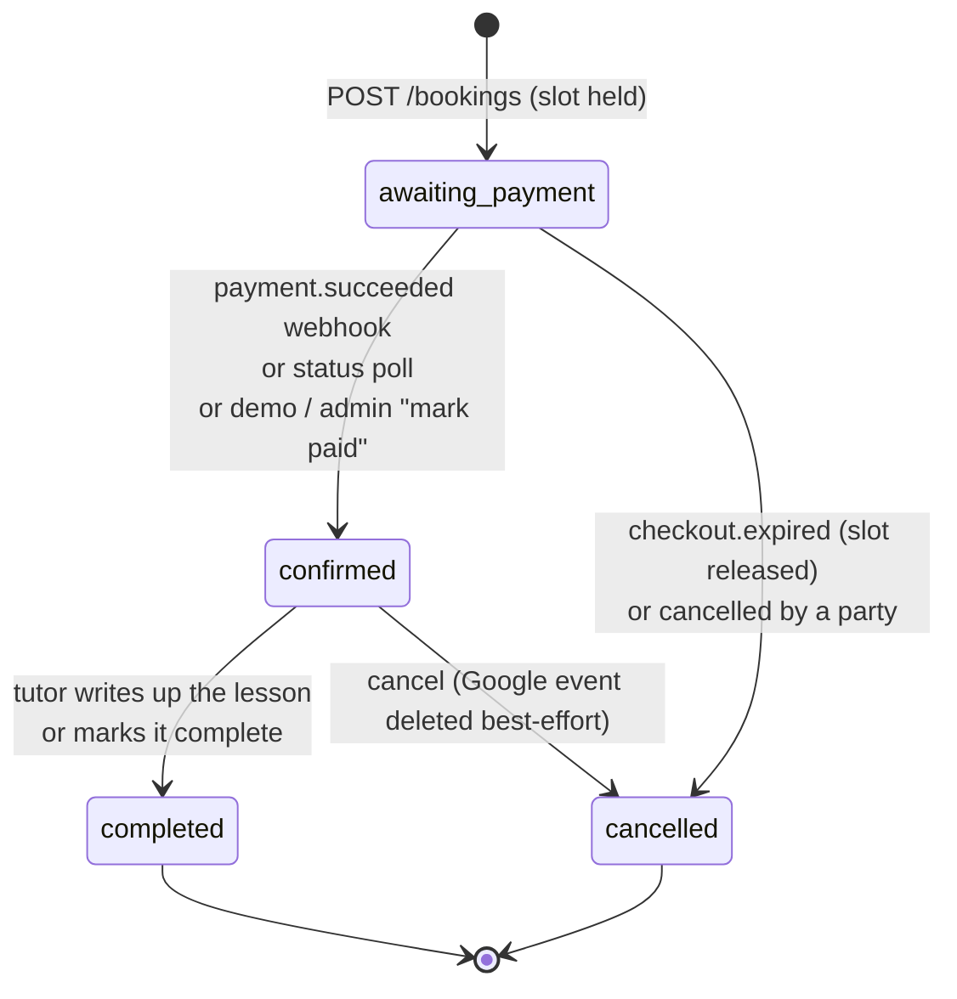
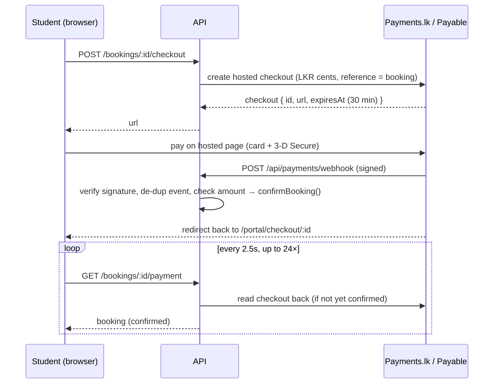
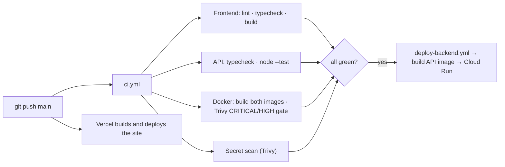

# Serendib Learn — the handbook

One document covering the whole product: what it is, how it looks and why,
how it is built, how each feature works, where it runs, and how to operate
it. It is the overview; the focused docs it links to go deeper on each topic
and stay the source of truth for step-by-step setup.

| For… | Go to |
| --- | --- |
| Running it locally, demo accounts | `README.md` |
| API internals, endpoints, security, tests | `server/README.md` |
| Deploying and the go-live checklist | `DEPLOYMENT.md` |
| Conventions for adding a page or endpoint | `.claude/skills/serendib-dev/SKILL.md` |
| Brand colours, fonts, logo, voice | `branding/brand-tokens.txt` |
| Live project ids, service accounts, URLs (private) | `DEPLOYMENT_NOTES.md` — local only, gitignored |

---

## Contents

1. [The product](#1-the-product)
2. [Who uses it](#2-who-uses-it)
3. [Design](#3-design)
4. [Architecture](#4-architecture)
5. [The frontend](#5-the-frontend)
6. [The API](#6-the-api)
7. [Data model](#7-data-model)
8. [Features in depth](#8-features-in-depth)
9. [Integrations](#9-integrations)
10. [Security and privacy](#10-security-and-privacy)
11. [Infrastructure and deployment](#11-infrastructure-and-deployment)
12. [Configuration reference](#12-configuration-reference)
13. [Testing and quality gates](#13-testing-and-quality-gates)
14. [Operations runbook](#14-operations-runbook)
15. [Parked, demo-shaped and next steps](#15-parked-demo-shaped-and-next-steps)
16. [Repository map](#16-repository-map)
17. [Glossary](#17-glossary)

---

## 1. The product

**Serendib Learn teaches Sinhala and Tamil live, one to one, with
Sri Lankan tutors.** Its learners have a personal reason to learn: a
grandparent to talk to, a move to Colombo, a wedding, a heritage they want
to keep. The tagline is *"Keeping languages alive."*

What the product does:

- **Public site.** A landing page (hero, About us, Why families choose
  Serendib, Register your interest), *How it works*, the tutor directory,
  a free **alphabet sheet** with audio for both scripts, and the privacy
  policy.
- **Member portal.**
  - Sign-up for students and tutors, with tutor approval.
  - A month calendar for booking lessons, with Sri Lankan holidays.
  - Card payment through **Payments.lk**.
  - Google Meet links created automatically.
  - A learning hub with materials filed under course chapters.
  - Homework, and a **feedback loop** after every lesson (ratings,
    write-ups, voice notes, reminders).
  - A **vetted community** with stories, practice partners, friend requests
    and messaging.
  - An admin area.

The course content follows two sources. One is the original site's
learning-hub stages (Foundation; Building & fluency). The other is the
eight **Survival Sri Lanka** chapters from
`docs/Serendib-Vocabulary-Cards.docx`.

This build replaces the original **Lovable prototype**, and reproduces that
prototype's look on purpose (see [Design](#3-design)).

---

## 2. Who uses it

| Role | How they arrive | What they can do |
| --- | --- | --- |
| **Visitor** | The public site | Read the site, browse tutors, use the alphabet sheet, join the waitlist |
| **Student** | `/portal/signup` | Book and pay for lessons, get materials and homework, give lesson feedback, join the community once vetted, message tutors and friends |
| **Tutor** | `/portal/signup?role=tutor` (then approved), or an admin invite | Publish weekly hours, run lessons, connect Google Calendar, write up lessons, assign materials and homework, track student progress, record alphabet audio |
| **Admin** | Promoted by another admin, or invited | Everything above, plus People, Tutor applications, Feedback, Moderation, Waitlist, Google connections and the Audit log |
| **Super admin** | `SUPER_ADMIN_EMAIL` or `npm run create-admin` | An admin who cannot be demoted or deleted from the admin area, so the owners can never be locked out |

**Account states:**

- **Verified:** the email was confirmed with a six-digit code, or the
  account was created through Google or an invite.
- **Membership** (`none` / `active`): becomes `active` with the first
  paid booking.
- **Tutor status** (`pending` / `approved` / `rejected`): only approved
  tutors are listed and bookable. A tutor with no status predates the
  approval process and counts as approved.
- **Vetted:** verified, and an active member, an approved tutor or an
  admin. Only vetted members appear in the community directory.

---

## 3. Design

### 3.1 Principles

- **Look like the original site.** The public pages, the portal frame,
  the login card, the calendar, the learning-hub folders and the community
  page all reproduce the original serendib.learn. Newer features are styled
  to match. The reference was the prototype's source
  (`serendib-heritage-academy-main.zip`, used during the rebuild and since deleted),
  plus the review tracker in `docs/Serendib_Website_Review_Tracker.xlsx`.
- **A boutique Colombo café, not a tech startup.** The brand brief rules
  out corporate blue, so a lilac mist (`#EEEDFE`) stands in wherever a
  "cool" tone is needed.
- **No drop shadows.** Cards are separated by a thin forest-green border
  (`rgb(27 67 50 / 0.12)`). `--shadow-card` and `--shadow-lifted` are both
  `none`.
- **Warm, personal, editorial voice.** The copy uses specific, human
  details ("a phone call with a grandparent, a work posting in
  Trincomalee") and avoids abstract claims or sales language.

### 3.2 Colour

The tokens are defined in `src/app/globals.css` (Tailwind v4 `@theme`) and
mirrored in `branding/brand-tokens.txt`.

| Token | Hex | Use |
| --- | --- | --- |
| `forest` | `#1B4332` | Primary: header, nav, dark sections, headings, browser theme colour |
| `fern` | `#2D6A4F` | Secondary text and accents |
| `sage` | `#95C4AA` | Muted text on dark backgrounds |
| `amber-spice` | `#C9873A` | Calls to action, links, hover, focus ring |
| `amber-light` | `#E8A855` | Lighter amber accents |
| `cream` | `#F7F3ED` | Page background |
| `earth` | `#2C2416` | Body text |
| `mist` | `#EBF4EF` | Soft green panels |
| `lilac-mist` | `#EEEDFE` | The cool accent in place of blue |

Older class names (`sand-*`, `ink-*`, `jade-*`, `saffron-*`, `clay-*`,
`ocean-*`) are tuned scales that resolve to the same palette, so earlier
components needed no rewrite.

### 3.3 Typography

- **Headings:** Georgia (fallback Times New Roman), regular weight 400,
  in forest. The serif carries the editorial weight.
- **Body and UI:** Inter, via `next/font`.
- **Scripts:** Noto Sans Sinhala and Noto Sans Tamil (`--font-sinhala`,
  `--font-tamil`), with Nirmala UI, Iskoola Pota and Latha as fallbacks.
- **Eyebrow labels:** the `label-eyebrow` utility, small caps text above
  section headings.

### 3.4 Logo and imagery

- **The mark** is a five-petal white Araliya (frangipani) flower with an
  amber centre, on a forest circle. It is drawn as a component in
  `src/components/site/araliya-flower.tsx`, and the PNGs are in
  `public/brand/` and `branding/Logo/`.
- **Lockups:** horizontal (on forest) and vertical (on cream). Keep clear
  space equal to the mark's height on every side.
- **App icons and share image:** `src/app/icon.png`, `apple-icon.png` and
  `opengraph-image.png`. `manifest.ts` makes the site installable ("Add to
  Home Screen"), as the prototype was.

### 3.5 Characters (avatars)

Members can pick a Sri Lankan character instead of showing their initials.
Each character doubles as a vocabulary lesson: it carries its word in both
scripts, a romanisation and a syllable-by-syllable pronunciation.

- **The ids** live in `shared/avatars.ts`. The API only accepts these
  ids.
- **The drawings** live in `src/components/ui/characters.tsx`.
- **The characters:** akka (elder sister), aiya (elder brother), aachchi
  (grandmother), seeya (grandfather), yaka (raksha mask), kotiya
  (leopard), aliya (elephant), monara (peacock) and ibba (turtle).

### 3.6 Components

Shared primitives are in `src/components/ui/`:

- `Button` and `ButtonLink`, with a `forest` variant among others and
  `rounded-md` corners.
- `Card`, `Badge`, `Avatar`, `Spinner`/`Loading`, `EmptyState`, `Alert`,
  `Progress`, `Stat` and `SectionHeading`.
- `Field` (form inputs), `Modal` and the Turnstile widget.

Reuse these rather than styling new ones.

**Site chrome** is in `src/components/site/`:

- **Header:** About us, Tutors, Alphabet, Portal, and a "Join the
  waitlist" button. On mobile it collapses into a menu that also has "Teach
  with us".
- **Footer**, logo and flower.
- **The demo inbox.**

The **portal frame** is `portal-shell.tsx`: the original site's top bar,
with section navigation from `portal-nav.tsx`:

- Home, Calendar, Learning hub, Homework, Community, Messages and Profile.
- Admin, for admins only.

Each page opens with `page-header.tsx`: an icon circle, an eyebrow and a
Georgia title.

### 3.7 Accessibility and responsiveness

- The focus ring is a 2px amber outline on `:focus-visible`.
- Text selection is saffron.
- Layouts are mobile-first and the header collapses below `md`.
- Sinhala and Tamil text always carries a romanisation and a
  plain-English sound hint, never the script alone.

---

## 4. Architecture

### 4.1 Shape

Two independently deployable services share one TypeScript contract.



| Path | What it is | Port | Hosted on |
| --- | --- | --- | --- |
| `/` | Next.js app: public pages and portal UI | 3000 | Vercel |
| `/server` | Express API: accounts, bookings and everything that is stored | 4000 | Google Cloud Run |
| `/shared` | Domain types, seed data, curriculum and avatars, imported by both sides | — | — |

### 4.2 Key decisions, and why

| Decision | Why |
| --- | --- |
| **Frontend and API are separate services** | They deploy independently. The site only knows the API through `NEXT_PUBLIC_API_URL`, so the API could move to its own host or repo without touching a component. |
| **`shared/types.ts` is the contract** | One change there is seen by both sides at compile time. |
| **A `Backend` interface in the frontend** (`src/lib/api/backend.ts`) | Every screen goes through it. `src/lib/api/index.ts` is the single line that chooses the implementation, which is how the original in-browser mock became a real API with a contained change. |
| **Node runs the API's TypeScript directly** (type stripping) | No build step and no bundler. As a result, relative imports need `.ts` and type-only imports need `import type`. |
| **A storage abstraction shaped like Mongo** (`Collection<T>`) | Routes are the same against a local JSON file (zero setup) and MongoDB Atlas (production). The swap needed no route changes. |
| **Opaque session tokens in an httpOnly cookie** | Simple to revoke (delete the row), there's nothing to verify client-side, and scripts can't read it. |
| **Hosted checkout for payments** | Card details never touch this app, so PCI scope stays with Payments.lk/Payable. |
| **The webhook confirms, and the status poll backs it up** | The webhook is authoritative in production. The poll covers localhost and slow webhooks. Confirmation is idempotent, so both can run. |
| **Google features are optional enhancements** | Without credentials, sign-in hides its button, bookings still confirm (a tutor adds a link by hand) and mail goes only to the demo inbox. Nothing breaks. |
| **Features are parked, not deleted** | The games are switched off by a flag, and their links are commented out with a `GAMES-HIDDEN` marker, so developers can bring them back. |
| **Revision counter instead of a client cache** | Every write bumps a counter and open queries refetch. It is simple and consistent, with no cache invalidation to get wrong. |

### 4.3 Technology

| Layer | Stack |
| --- | --- |
| Frontend | Next.js 16.3.8 (App Router), React 19.2, Tailwind CSS v4, lucide-react icons, `next/font` (Inter, Noto Sans Sinhala/Tamil) |
| API | Express 5 on Node 24, `helmet`, `cors`, `express-rate-limit`, `zod`, `mongodb` driver 7, `googleapis` / `google-auth-library`, `@payments-lk/node` |
| Storage | MongoDB Atlas (production), a JSON document file (local default), `mongodb-memory-server` (tests) |
| Tooling | TypeScript 5, ESLint 9 (`eslint-config-next`), Node's own test runner (`node --test`) |
| Infrastructure | Vercel, Google Cloud Run, Artifact Registry, Secret Manager, Cloud Scheduler, GitHub Actions with Workload Identity Federation, Trivy |

> **Next.js note:** this Next.js version has breaking changes compared with
> older releases. Read `node_modules/next/dist/docs/` before writing
> framework code (see `AGENTS.md`). One example: typed `LayoutProps<"/">`
> props, and `next typegen` running before `tsc`.

---

## 5. The frontend

### 5.1 Routes

**Public** (`src/app/(public)/`, shared header and footer):

| Route | Page |
| --- | --- |
| `/` | Home. **Hero:** "Tutors for Sri Lankans wherever they call home". **About us:** the process. **Why families choose Serendib:** the promise. **Register your interest:** the waitlist form. |
| `/how-it-works` | Four stages: tell us why you're learning → pick a tutor and a time → have the lesson → practise in between |
| `/tutors` | Approved tutors from `GET /users/tutors`, fetched server-side with `revalidate = 60` (no emails exposed), with their photos. A tutor listed without an email yet shows "Ask for a lesson" instead of availability. |
| `/alphabet` | The Sinhala and Tamil alphabet sheets with audio; tutors can record letters here |
| `/privacy` | The original privacy text, plus a "Services we use" section |
| `/games/**` | **Parked.** Every route 404s while `features.games` is false |

**Portal, signed out** (`src/app/portal/`):

- `login`, `signup` (`?role=tutor` for tutors), `verify` (six-digit code),
  `forgot-password` and `reset-password`.
- These pages share `auth-card.tsx`, the original login card.

**Portal, signed in** (`src/app/portal/(app)/`, wrapped in `PortalShell`):

| Route | Page |
| --- | --- |
| `/portal` | A "Welcome back" hub, plus a role dashboard (`dashboard-student`, `-tutor` or `-admin`) with a `GlanceHeader` |
| `/portal/calendar` | Month calendar with dots for open hours, sessions and holidays; a day panel with inline booking; the Sri Lankan holidays panel; tutors' weekly hours and Google Calendar connection |
| `/portal/checkout/[id]` | Sends the student to Payments.lk, then polls the payment status on return (every 2.5s, up to 24 times) |
| `/portal/learning-hub` | Chapters grouped by stage as folders (`chapter-browser.tsx`), with materials, phrase lists and, for admins, chapter management |
| `/portal/homework` | Assign, submit and review |
| `/portal/community` | "Stories worth keeping" (story, review, idea and photo posts), a share card, kind filters, practice partners and friends |
| `/portal/messages` | Conversations |
| `/portal/profile` | Profile editor and character picker |
| `/portal/admin` | Tabs: People, Tutor applications, Feedback, Moderation, Waitlist, Google, Audit log (`?tab=google` deep-links to Google) |

**Feedback prompt.** `feedback-prompt.tsx` sits at the top of every portal
page whenever the signed-in person owes feedback or a write-up for a lesson
that has ended.

### 5.2 Data flow

```
component ──useQuery(() => api.bookings.list(...), deps)──► Backend interface
                                                              │
                                     src/lib/api/http-backend.ts (fetch, credentials: "include")
                                                              │
                                                       Express API /api/...
writes ──useAction(...)──► http-backend ──► API ──► bumpRevision() ──► every open useQuery refetches
```

- **`src/lib/hooks.ts`:**
  - `useQuery(loader, deps)` reruns when `deps` change, or when the
    revision counter bumps. On a revision-triggered refetch it **keeps the
    old data on screen**, so writes don't blank pages, and exposes
    `refetching`.
  - `useAction` wraps a mutation with pending and error state.
  - `useTimezone()` returns the browser's IANA zone (empty during SSR, to
    keep hydration stable).
- **`src/lib/api/revision.ts`** is a tiny external store (counter plus
  listeners), read with `useSyncExternalStore`.
- **`src/lib/auth.tsx`** is the `AuthProvider` and session context. It
  calls `GET /auth/me`. A failed session check (API unreachable or rate
  limited) is **not** treated as being logged out.
- **`src/lib/api/public.ts`** holds the server-side fetches for public
  pages, such as the tutors list.
- **`src/lib/types.ts`** re-exports `shared/types.ts`.

### 5.3 Notable frontend modules

| Module | What it does |
| --- | --- |
| `src/components/alphabet/alphabet-view.tsx` | Renders the alphabet sheets. **Playback priority:** a tutor's recording, then the generated Tamil file, then the browser's speech synthesis. `RecordChip` gives signed-in tutors a record mode. Marks with no sound of their own get no audio. |
| `src/data/alphabet.ts` | Every letter: script, romanisation, plain-English sound hint, IPA, example word. Groups: Sinhala (vowels, everyday consonants, two signs, aspirated/formal letters) and Tamil (vowels, hard/soft/middle consonants, and more). `audioKey()` names each letter's audio file. Drafted with AI and labelled for tutor review. |
| `src/data/holidays.ts` | Sri Lanka's 2026 gazetted holidays (Poya, national, Hindu, Muslim, Christian), each with a fun fact. Copied from the original site. Lunar dates need a yearly check. |
| `src/data/vocabulary.ts`, `heritage.ts` | Survival Sri Lanka phrase lists, used by chapters, and the parked games' content |
| `month-calendar.tsx`, `holidays-panel.tsx` | The original calendar. Day keys are local `yyyy-mm-dd`, never `toISOString` (which shifts days across UTC midnight). |
| `voice-recorder.tsx`, `voice-note-player.tsx` | `MediaRecorder` capture, capped at **180 seconds**; playback of private notes |
| `feedback-prompt.tsx`, `feedback-list.tsx` | The in-portal half of the feedback loop |
| `google-*-connect.tsx`, `google-button.tsx` | Google sign-in button and the Calendar/Gmail connection cards |
| `demo-inbox.tsx` | The bottom-right panel that shows every "email" in demo mode, and resets the data |
| `src/lib/features.ts` | `features = { games: false }`, the switch for parked features |

### 5.4 Frontend headers

`next.config.ts` sets:

- `X-Frame-Options: SAMEORIGIN`, `nosniff`, `strict-origin-when-cross-origin`
  and HSTS.
- `Permissions-Policy: camera=(), microphone=(self), geolocation=()`. The
  microphone is allowed for voice notes and alphabet recording.

There is deliberately **no CSP** yet. Google Identity Services and
Turnstile load external scripts, so a strict CSP needs per-request nonces.

`output: "standalone"` is used for the Docker image only. It's off when
`VERCEL` is set, because the two clash.

---

## 6. The API

### 6.1 Request pipeline (`server/src/index.ts`)

```
trust proxy (1 hop, Cloud Run)
→ helmet()
→ cors({ origin: CORS_ORIGINS allowlist, credentials: true })
→ POST /api/payments/webhook   ← raw body, mounted BEFORE json (signature covers exact bytes)
→ express.json({ limit: 256kb })  (skipped for /api/voice-notes, /api/post-images, /api/alphabet-audio,
                                   which bring their own 5mb / 3mb / 2mb parsers)
→ parseCookies → loadSession (cookie → request.user)
→ /api rate limiter
→ routers (auth has its own stricter limiter)
→ 404 → errorHandler (ApiError → JSON { error, code })
```

On boot, the API:

1. Connects to the store (Mongo if `MONGODB_URI` is set, otherwise JSON),
   and seeds an empty database.
2. Runs `ensureSuperAdmin()`.
3. Starts the reminder timer.
4. Listens. The log says which store is in use and whether demo mode is
   on.

### 6.2 Routers

The full endpoint table is in `server/README.md` → "Endpoints".

| Mount | File | Covers |
| --- | --- | --- |
| `/api/auth` | `routes/auth.ts` | Sign-up (zod-validated, optional Turnstile), verify, resend, login, Google sign-in, logout, forgot and reset password, `me` |
| `/api/users` | `routes/users.ts` | Admin user list, directory, public tutors, invite, roles, tutor status, membership, delete, profile patch, tutees and tutors, audit log |
| `/api/availability` | `routes/availability.ts` | Weekly rules and open slots |
| `/api/bookings` | `routes/bookings.ts` | Create, checkout, payment status, demo/admin pay, cancel, complete, meeting link |
| `/api/payments` | `routes/payments.ts` | `GET /config`. The webhook handler is mounted separately (above). |
| `/api/feedback`, `/api/voice-notes` | `routes/feedback.ts` | Pending items, ratings, lesson write-ups, voice notes |
| `/api/chapters` | `routes/chapters.ts` | Course chapters (admins write) |
| `/api/materials` | `routes/materials.ts` | Library, assign, file under a chapter |
| `/api/homework` | `routes/homework.ts` | Assign, submit, review |
| `/api` (progress) | `routes/progress.ts` | Lesson notes, tutor's progress view |
| `/api/posts`, `/api/post-images` | `routes/community.ts` | Posts, likes, replies, moderation, photos |
| `/api/community` | `routes/connections.ts` | Practice partners, friend requests |
| `/api/threads` | `routes/messages.ts` | Conversations and messages |
| `/api/alphabet-audio` | `routes/alphabet-audio.ts` | Public list and audio; tutors and admins upload or delete |
| `/api/profile-photos` | `routes/profile-photos.ts` | Tutor photos: public for listed tutors; the tutor or an admin uploads or removes |
| `/api/integrations` | `routes/integrations.ts` | Google Calendar (per tutor and system), Gmail, OAuth callback, test buttons |
| `/api/jobs` | `routes/jobs.ts` | `POST /reminders`, guarded by `X-Cron-Secret` |
| `/api/waitlist`, `/api/mail`, `/api/demo`, `/api/games` | `routes/misc.ts` | Waitlist, demo inbox, demo reset, game results |
| `/api/health` | `index.ts` | `{ ok, demoMode }` |

### 6.3 Libraries (`server/src/lib/`)

| File | Responsibility |
| --- | --- |
| `sessions.ts` | `sl_session` cookie (30 days), `loadSession`, `requireAuth`, `requireAdmin`, `requireSelfOrAdmin` |
| `passwords.ts` | scrypt hashes stored as `scrypt$salt$hash`, constant-time compare, random tokens, six-digit codes |
| `accounts.ts` | Password links (reset 24h, invite 7 days), invites, `notifyAdmins`, `ensureSuperAdmin` |
| `domain.ts` | 60-minute slots, 2-hour booking notice, price = hourly rate × duration (default $25/h), bookable tutors, public tutor shape, progress, tutees |
| `payments.ts` | Payments.lk client: config, LKR conversion, `checkoutFor` (reuses an open checkout), `refreshFromCheckout`, `verifyWebhook` |
| `booking-confirmation.ts` | `scheduleMeeting` (tutor's calendar, then the system calendar, then none) and idempotent `confirmBooking` |
| `feedback.ts` | Lesson end time, 14-day feedback window, who still owes what |
| `reminders.ts` | Lesson reminders (24h and 1h before), feedback reminders (at the end of class, then 24h later), the timer |
| `community.ts` | `isVetted`, friendships, `mayMessage` |
| `google.ts` | OAuth URLs and code exchange, Meet event create/delete, `sendGmail`, ID-token verification |
| `mail.ts` | `deliver()`: always records to the demo inbox, and also sends through Gmail when connected; never throws on a failed send |
| `rate-limit.ts`, `turnstile.ts`, `validate.ts`, `audit.ts`, `errors.ts`, `http.ts`, `ids.ts` | Cross-cutting helpers |

### 6.4 Storage layer (`server/src/db/`)

- **`store.ts`** is the JSON-file store and the `Collection<T>` interface:
  `find`, `findOne`, `findById`, `insertOne`, `updateOne`, `deleteOne` and
  `count`, with Mongo-style filters (`$in`, `$ne`, `$gt`, `$lt`, `$exists`).
- **`mongo-store.ts`** is the same interface over the MongoDB driver.
  - Documents keep the app's own string `id`, with a unique index on it.
    `_id` is stripped on every read.
  - Sorting takes a JavaScript comparator, so it runs in Node after the
    filter.
  - An update that sets a field to `undefined` becomes a `$unset`, and an
    empty update is never sent.
- **`database.ts`** declares the typed collections, picks the store, seeds
  the database and reseeds it.
  - The demo seed is skipped when `DEMO_MODE=false`.
  - The default chapters are written whenever the chapters collection is
    empty.

---

## 7. Data model

All ids are prefixed strings, for example `bk_37d33cf08f` or `u_nimali`.
Timestamps are ISO strings.

| Collection | Holds | Notes |
| --- | --- | --- |
| `users` | `User` | Role, verification, membership, languages, timezone, tutor profile fields, `tutorStatus`, `superAdmin`, `avatarId`, `openToPractice`, `googleId` |
| `credentials` | Password hash per user | Never leaves the server |
| `sessions` | Opaque token → user, with expiry | |
| `verificationCodes` | Six-digit email codes | |
| `resetTokens` | Single-use reset and invite links | `expiresAt` |
| `availability` | `AvailabilityRule` | Weekday plus local `HH:mm` start and end |
| `bookings` | `Booking` | Status, price, Meet link, Google event and owner, `payment`, `lessonReminders`, `feedbackReminders`, `cancelReason` |
| `paymentEvents` | Processed webhook event ids | De-duplication |
| `lessonNotes` | Tutor write-ups | Summary, went well, work on, vocabulary, optional voice note |
| `feedback` | `SessionFeedback` | 1–5 rating, comment, optional voice note |
| `voiceNotes` | Audio (base64) and metadata | Visible only to the two people on the lesson, and admins |
| `chapters` | `CourseChapter` | Stage, order, optional link to a vocabulary list |
| `materials` | `Material` | pdf, audio, video, link or deck; language; level; `assignedTo`; `chapterId` |
| `homework` | `HomeworkItem` | assigned → submitted → reviewed, with score |
| `posts`, `replies`, `postImages` | Community content | Posts are moderated: pending, approved or rejected |
| `connections` | Friend requests | pending, accepted or declined |
| `threads`, `messages` | Conversations | `readBy` per message |
| `alphabetAudio` | Tutor recordings per language and letter key | |
| `profilePhotos` | Tutor photos (base64), keyed by user id | `User.photoId` versions the URL |
| `waitlist` | "Register your interest" entries | |
| `mail` | Every outgoing message (the demo inbox) | |
| `auditLog` | Admin actions | |
| `googleAccounts` | Calendar refresh tokens per tutor, plus the `"system"` row | Never sent to the browser |
| `googleMailer` | The single Gmail sender (`"system"`) | |
| `oauthStates` | OAuth CSRF state | |
| `gameResults` | Parked games' scores | |

### Booking lifecycle



Both `awaiting_payment` and `confirmed` hold the tutor's slot.

---

## 8. Features in depth

### 8.1 Accounts and sign-in

- **Sign-up.** The person gives their name, email, password (validated by
  zod), role, languages, timezone and character. Tutors can also fill in
  an optional application: headline, bio, home town and years teaching.
  A six-digit code is emailed, and the account is verified at
  `/portal/verify`.
- **Login.** Login answers a wrong password and an unknown email with the
  **same message**, so it can't be used to find out which emails have
  accounts.
- **Google sign-in.** The Google Identity Services ID token is verified on
  the server. With `intent: "login"` it never creates an account; an
  unknown person is sent to sign-up to choose a role first. Signing in
  with Google links to an existing account that has the same email.
- **Passwords.** Passwords are hashed with scrypt from Node's crypto
  module. Reset links last 24 hours; invite links last 7 days.
- **Sessions.** A random token goes in an httpOnly `sl_session` cookie for
  30 days. In production the cookie is `SameSite=None; Secure`, because
  Vercel and Cloud Run are on different domains.
- **Tutor approval.** Applicants stay `pending` (unlisted and unbookable),
  and admins are emailed. An admin approves or rejects under
  Administration → Tutor applications.
- **Invites.** An admin creates someone's account already verified (and
  approved, for tutors). The person gets an email to set their password.
- **Tutors listed before they have an email.** An admin can add a tutor
  with no email address. Their profile and photo appear on the public
  Tutors page straight away, but they aren't bookable and can't be
  messaged until an admin uses **Add email & invite** in Administration →
  People. That sends the invite and makes them bookable.
- **Super admin.** `SUPER_ADMIN_EMAIL` ensures the owners' account on
  every boot: it is created if missing and promoted if it exists as
  something else. An existing password is never changed. Production keeps
  only the owners' super admin and the accounts they chose to keep.

### 8.2 Tutors, availability and booking

- **Profiles.** Tutors fill in a headline, bio, home town, years teaching,
  specialties, hourly rate (USD) and languages. The public tutors page
  never shows emails.
- **Hours.** Tutors publish weekly blocks, for example "Monday 09:00–12:00".
  Open slots are 60-minute hours inside those blocks. They start at least
  2 hours from now, and exclude any slot that overlaps an
  `awaiting_payment` or `confirmed` booking.
- **Booking.** A student books from the calendar's day panel: they pick
  an open hour, then give the language and a focus. This creates an
  `awaiting_payment` booking priced at rate × duration, and the student
  goes to checkout.
- **Meeting link.** On confirmation, the API creates a Google Calendar
  event with Meet on the tutor's calendar, or else on the shared Serendib
  calendar. Google invites both people. If neither calendar is connected,
  the tutor adds a link by hand.
- **Cancelling.** Either party can cancel, and the Google event is deleted
  on a best-effort basis.

### 8.3 Payments (Payments.lk)



- **Mode.** The key decides it: `sk_test_…` takes sandbox payments on
  Payable's sandbox, and `sk_live_…` takes real ones. Without a key, a
  **demo checkout** confirms bookings without charging.
- **Currency.** Tutors price in USD. Checkouts are in LKR at `USD_TO_LKR`
  (default 300), so a $28 lesson is Rs. 8,400.
- **Checkout reuse.** An open checkout with more than a minute left is
  reused rather than a new one being created.
- **Webhook.** The webhook is verified against the raw body with
  `PAYMENTS_LK_WEBHOOK_SECRET` (with a five-minute replay window), and
  each event id is processed once (`paymentEvents`).
  - `payment.succeeded` confirms the booking, but only if the amount
    matches what was asked.
  - `payment.failed` records the decline reason.
  - `checkout.expired` cancels the booking, releases the slot and emails
    the student.
  - A bad signature returns 400. If payments aren't configured, the
    endpoint returns 404.
- **Confirmation** (`confirmBooking`) is idempotent. It:
  - sets `confirmed` and `paidAt`;
  - creates the Meet link;
  - activates the student's membership;
  - emails a receipt (amount, card's last four digits, Meet link) and a
    tutor notice.
- **Admin "mark paid".** Once a key is set, students can't use the instant
  `/pay` endpoint. Admins keep it to record a payment taken some other
  way.
- **Status (October 2026):** production runs the **sandbox**. A test-card
  payment and a signed webhook were verified end to end. Going live only
  means swapping in the live key and the live webhook secret after
  Payments.lk approves the account.

### 8.4 Learning hub: chapters and materials

- **Chapters.** A fresh database starts with these stages:
  - **Foundation:** alphabet, Say hello, Who's who, Calling grandma.
  - **Survival Sri Lanka:** Arriving, Finding your driver, Tuk tuk
    adventure, At the shop, Ordering food, Finding the bathroom, Weather
    chat, Meeting relatives.
  - **Building & fluency:** Holding a conversation, Telling your own
    story.
  - **Worksheets & printables.**

  Admins can rename, reorder, add and remove chapters. Deleting a chapter
  unfiles its materials rather than deleting them. Survival chapters link
  to their phrase lists, so no chapter is ever empty.
- **Materials.** A material is a pdf, audio, video, link or deck, with a
  language (Sinhala, Tamil or both) and a level. Its owner files it under
  a chapter and assigns it to students.
- **Homework.** A tutor sets a title, brief and due date. The student
  submits a note, and the tutor reviews it with feedback and a score.
- **Progress.** A tutor sees, for each student: lessons completed and
  upcoming, homework outstanding, average score, last lesson and chapters
  practised.

### 8.5 The feedback loop

1. Once a lesson's end time passes, `GET /feedback/pending` lists it for
   both sides. The student owes a **rating** (1–5, a comment and an
   optional voice note). The tutor owes a **write-up**: summary, what went
   well, what to work on, vocabulary introduced and an optional voice
   note. Writing it up also marks the booking `completed`.
2. The portal shows `feedback-prompt.tsx` on every page until it is done.
3. **Email reminders** go out at the end of class and once more 24 hours
   later, only for what's still missing, within a 14-day window. They are
   recorded on the booking, so none is sent twice.
4. **Voice notes:**
   - **Upload:** base64 JSON with a 5 MB limit, up to 3 minutes long.
   - **Who can hear them:** only the two people on the lesson, and admins.
   - **Who can attach them:** only the author, to their own feedback or
     write-up.
5. Admins see all feedback under Administration → Feedback.

Before the lesson, **lesson reminders** go to both people 24 hours ahead
and 1 hour ahead, with the Meet link and a link to the calendar.

### 8.6 Alphabet sheet

- **Content.** `/alphabet` shows both scripts. Each letter has a
  romanisation, a sound hint, IPA and an example word. The page says the
  sheet was drafted with AI for tutor review.
- **Tamil audio.** Tamil plays generated files in
  `public/audio/alphabet/tamil/` (83 files). They were made by
  `node scripts/generate-alphabet-audio.mjs` using Google Cloud
  Text-to-Speech, voice `ta-IN-Wavenet-A`.
- **Sinhala audio.** Google has **no Sinhala voice**. Sinhala audio comes
  from tutors recording each letter on the page (signed in → "Record
  pronunciations"). Recordings are served by `/api/alphabet-audio`, and a
  tutor's recording also replaces the generated Tamil file.
- **Fallback.** When there's no file, the browser's speech synthesis is
  used if it has a voice for the language.

### 8.7 Community

- **Vetted only.** Everyone listed is verified, and is a paying student,
  an approved tutor or the team.
- **Posts.** "Stories worth keeping" posts come in four kinds: story,
  review, idea and photo. A post can carry an uploaded photo (3 MB limit).
  New posts are **moderated** (pending → approved or rejected, with a
  note). There are likes and replies.
- **Practice partners.** The directory lists vetted members who haven't
  opted out (`openToPractice: false`), filtered by language. It never
  shows contact details.
- **Friend requests.** A request can be accepted, declined (quietly),
  cancelled or removed. Asking someone who has already asked you accepts
  their request.
- **Messaging.** Students can message each other only while they are
  friends. Anything involving a tutor or admin is open. Conversations
  never expose email addresses.

### 8.8 Admin area

| Tab | Purpose |
| --- | --- |
| People | Every account: change roles and membership, delete accounts (not super admins), invite someone, edit profiles |
| Tutor applications | Approve or reject pending tutors |
| Feedback | All lesson ratings and write-ups |
| Moderation | Approve or reject community posts |
| Waitlist | "Register your interest" entries |
| Google | Connect the shared Serendib calendar and the Gmail sender, with **test buttons** for each. The admin dashboard warns while either is missing. |
| Audit log | Role and membership changes, deletions and moderation decisions |

### 8.9 Demo mode

When `DEMO_MODE` is anything other than `false`:

- Seeded accounts exist, all with the password `serendib` (see
  `README.md`).
- The **Demo Inbox** shows every email.
- `POST /demo/reset` restores the seed.

Production runs with `DEMO_MODE=false`, which closes the inbox and the
reset endpoint, and never seeds the database.

---

## 9. Integrations

| Service | Used for | Turned on by | Without it |
| --- | --- | --- | --- |
| **Google Sign-In** | "Continue with Google" | `GOOGLE_CLIENT_ID` (API) and `NEXT_PUBLIC_GOOGLE_CLIENT_ID` (site) | The button is hidden |
| **Google Calendar and Meet** | A real event and Meet link per booking | `GOOGLE_CLIENT_SECRET`, plus a tutor connecting their calendar, or an admin connecting the shared Serendib calendar | No link; the tutor adds one by hand |
| **Gmail** | Real email (codes, receipts, reminders, invites) | An admin connecting the sender under Admin → Google | Mail only goes to the demo inbox |
| **Payments.lk** | Card payments | `PAYMENTS_LK_SECRET_KEY` and `PAYMENTS_LK_WEBHOOK_SECRET` | Demo checkout |
| **Cloudflare Turnstile** | CAPTCHA on sign-up and the waitlist | `TURNSTILE_SECRET_KEY` and `NEXT_PUBLIC_TURNSTILE_SITE_KEY` | No CAPTCHA |
| **Google Cloud Text-to-Speech** | Generating the Tamil alphabet audio (offline script) | Run by hand with Google Cloud credentials | Speech synthesis fallback |
| **Cloud Scheduler** | Runs reminders every 5 minutes | `CRON_SECRET` and the scheduler job | Reminders only run while an instance is awake |

**Google OAuth scopes:** `calendar.events`, `gmail.send` and
`userinfo.email`. The first two are sensitive scopes. Until the consent
screen is published and verified, Google shows an "unverified app" warning
and caps use at 100 test users.

Refresh tokens are stored server-side only, in `googleAccounts` and
`googleMailer`.

---

## 10. Security and privacy

- **Transport and headers.** The API sends `helmet()` defaults (CSP,
  framing, nosniff, HSTS). The site sends its own headers (§5.4).
- **CORS and CSRF.** `CORS_ORIGINS` is an exact allowlist, never a
  wildcard, with credentials. Every write is JSON, which forces a
  preflight that a foreign origin fails. There is no separate CSRF token,
  so keep both rules.
- **Rate limits.** 1,500 requests per 15 minutes on `/api`, and 20
  credential attempts per 15 minutes on `/api/auth`. `GET /auth/me` and
  logout don't count toward the auth limit. Limits key off the real
  client IP (`trust proxy` set to 1).
- **Authorization.** Every route checks `requireAuth`, `requireAdmin` or
  `requireSelfOrAdmin`. Writes also check ownership:
  - only the tutor who set homework can mark it;
  - only the owner of a material can assign it;
  - only a party to a booking can cancel it.
- **Input.** zod validates auth and profile bodies. Every value is coerced
  with `String()` or `Number()` before it reaches a filter, which blocks
  NoSQL operator injection.
- **Secrets.** In production, secrets live in Google Secret Manager,
  never in the repo or GitHub. The CI secret scan (Trivy) fails on
  committed secrets. Keys are pasted into Secret Manager with
  `pbpaste | tr -d '[:space:]' | gcloud secrets versions add …`, which
  keeps them out of shell history and chat.
- **Payments.** Card data never touches this app. Webhooks are
  signature-verified, protected against replay and de-duplicated, and
  amounts are checked.
- **Privacy by design:**
  - Members only ever see other members' public profiles (no emails).
  - Voice notes are private to the lesson's two people.
  - Practice-partner listing is opt-out.
  - The privacy page lists the outside services used.
- **Audit.** Admin actions are logged to `auditLog`.
- **Not done yet:** request logging with actor and IP, a strict frontend
  CSP, and documented secret rotation.

---

## 11. Infrastructure and deployment

| Piece | Where | Deployed by |
| --- | --- | --- |
| Site | **Vercel** (Next.js native builds; a preview URL for every PR) | Vercel's GitHub integration, on every push to `main` |
| API | **Google Cloud Run** `serendib-api` (scales to zero, public) | `.github/workflows/deploy-backend.yml`, after CI passes on `main` |
| Images | Artifact Registry repo `serendib` | Same workflow |
| Database | **MongoDB Atlas** (M0), database `serendib_learn` | — |
| Secrets | **Secret Manager**: `MONGODB_URI`, `GOOGLE_CLIENT_ID`, `GOOGLE_CLIENT_SECRET`, `CRON_SECRET`, `PAYMENTS_LK_SECRET_KEY`, `PAYMENTS_LK_WEBHOOK_SECRET` | Referenced as `:latest` in the deploy |
| Jobs | **Cloud Scheduler** runs `serendib-reminders` every 5 minutes (`POST /api/jobs/reminders`) | One-time setup |
| Auth from CI to GCP | Workload Identity Federation (no stored keys) | One-time setup |

### CI/CD pipeline



**Deploy environment.**

- **Environment variables:** `DEMO_MODE=false`, `COOKIE_SAMESITE=none`,
  `COOKIE_SECURE=true`, `CORS_ORIGINS=$APP_URL`,
  `GOOGLE_REDIRECT_URI=$API_URL/api/integrations/google/callback` and
  `MONGODB_DB_NAME`.
- **GitHub variables:** `APP_URL` and `API_URL`, with **no trailing
  slash**. A trailing slash silently breaks CORS.

**Runtime identity.** Both the deployer service account and the runtime
(default Compute) service account need `secretAccessor` on every secret.

**Docker.** The root `Dockerfile` builds the site and `server/Dockerfile`
builds the API.

- Both build from the repo root, because both need `shared/`.
- Both remove npm's bundled CLI after the build, to clear vendored CVEs.
- `docker compose up --build` runs Mongo, the API and the site together
  for local use. It is not how production is deployed.

Full one-time setup is in `DEPLOYMENT.md`, sections 1–10, with a go-live
checklist.

---

## 12. Configuration reference

**API** (`server/.env`; in production, Cloud Run environment variables and
secrets):

| Variable | Default | Purpose |
| --- | --- | --- |
| `PORT` | 4000 | Listen port |
| `CORS_ORIGINS` | localhost:3000, 3001 | Allowed credentialed origins |
| `MONGODB_URI` / `MONGODB_DB_NAME` | empty / `serendib_learn` | Mongo connection (empty uses the JSON store) |
| `DATA_FILE` | `server/data/db.json` | JSON store location |
| `COOKIE_SAMESITE` / `COOKIE_SECURE` | `lax` / `false` | Session cookie flags |
| `DEMO_MODE` | on | `false` disables the seed, demo inbox and reset |
| `GOOGLE_CLIENT_ID` / `GOOGLE_CLIENT_SECRET` / `GOOGLE_REDIRECT_URI` | empty | Google sign-in, Calendar and Gmail |
| `APP_URL` | localhost:3000 | Links in emails; the redirect after OAuth |
| `TURNSTILE_SECRET_KEY` | empty | CAPTCHA |
| `PAYMENTS_LK_SECRET_KEY` / `PAYMENTS_LK_WEBHOOK_SECRET` | empty | Payments (empty means the demo checkout) |
| `USD_TO_LKR` | 300 | Rupees per dollar |
| `REMINDER_INTERVAL_MS` | 60000 | In-process reminder timer (0 turns it off) |
| `CRON_SECRET` | empty | Enables `POST /api/jobs/reminders` |
| `SUPER_ADMIN_EMAIL` / `_NAME` / `_PASSWORD` | empty | Owners' account bootstrap |
| `RATE_LIMIT_SCALE` | 1 | Tests only |

**Site** (`.env.local`; in production, Vercel environment variables, baked
in at build time):

| Variable | Purpose |
| --- | --- |
| `NEXT_PUBLIC_API_URL` | Where the API is (default localhost:4000) |
| `NEXT_PUBLIC_GOOGLE_CLIENT_ID` | The same client id as the API's |
| `NEXT_PUBLIC_TURNSTILE_SITE_KEY` | CAPTCHA site key |
| `NEXT_PUBLIC_SITE_URL` | Absolute URLs for share images (default `https://www.serendiblearn.com`) |

---

## 13. Testing and quality gates

| Gate | Command | Runs in CI |
| --- | --- | --- |
| Lint | `npm run lint` | ✓ |
| Typecheck (site) | `npm run typecheck` (`next typegen && tsc --noEmit`) | ✓ |
| Build (site) | `npm run build` | ✓ |
| Typecheck (API) | `npm --prefix server run typecheck` | ✓ |
| Tests (API) | `npm --prefix server test` | ✓ |
| Image vulnerabilities | Trivy on both images, failing on fixable CRITICAL/HIGH | ✓ |
| Secret scan | Trivy filesystem scan | ✓ |

**How the API tests work.**

- The tests use Node's own runner and an in-memory MongoDB, over real
  HTTP. There are 13 test files.
- `startTestServer(env)` boots the real app with per-file environment
  variables.
- Payments run the real SDK against `test-support/fake-payments-lk.ts`.

**What's covered.**

- Accounts: sign-up, verify and login; password reset and invites; tutor
  approval; the super admin.
- Bookings, and Payments.lk: pricing, checkout reuse, forged and replayed
  signatures, wrong amounts, expiry.
- Feedback and reminders, and voice-note privacy.
- Chapters, connections and messaging, alphabet audio.
- Rate limits, and the Mongo store's handling of `undefined` updates.

**Not covered yet.**

- Materials beyond chapters, homework and posts.
- The Google integrations.
- All frontend behaviour, which is checked by hand in a browser.

Before pushing, run the four commands in `DEPLOYMENT.md` → "Local testing".

---

## 14. Operations runbook

| Task | How |
| --- | --- |
| Deploy | Push to `main`. CI runs, then the API deploys and Vercel builds the site. |
| Check API health | `GET /api/health` |
| Check payments | `GET /api/payments/config` returns `{ enabled, mode, usdToLkr }` |
| Go live with payments | After Payments.lk approval, add the `sk_live_…` key and the live webhook's `whsec_…` as new secret versions (`pbpaste` method), disable the old versions, and redeploy. No code changes. |
| Rotate a secret | `gcloud secrets versions add <NAME> --data-file=-`, disable the old version, redeploy |
| Change the exchange rate | Add `USD_TO_LKR=<rate>` to `deploy-backend.yml`'s `env_vars` |
| Create or restore the owners' admin | `SUPER_ADMIN_EMAIL` on deploy, or `npm --prefix server run create-admin -- --email … --name "…"` |
| Bring on a tutor | They apply at `/portal/signup?role=tutor` and you approve them, or you invite them from Admin → People |
| Connect Google | Publish the OAuth consent screen, then in Admin → Google connect the Serendib calendar and Gmail and press the test buttons |
| Webhook logs | Cloud Run logs for `/api/payments/webhook`: 200 is fine, 400 is a bad signature, 404 means payments aren't configured |
| Reminder job | Cloud Scheduler `serendib-reminders`. Without the header the endpoint returns 403. |
| Reseed (local only) | `npm --prefix server run seed` |
| Back up the production database | Export the collections to JSON (an earlier backup is in `server/data/backups/`, which is gitignored) |
| Update holidays | Edit `src/data/holidays.ts` each year (lunar dates shift) |
| Regenerate Tamil audio | `node scripts/generate-alphabet-audio.mjs` (needs Google Cloud TTS) |

**Common problems.**

- **Every API call fails from the site:** a trailing slash in
  `APP_URL`, or a missing `CORS_ORIGINS` entry.
- **"Permission denied on secret" on deploy:** the runtime service
  account is missing `secretAccessor`.
- **Vercel `.nft.json` error:** `output: "standalone"` is leaking into
  the Vercel build.
- **CI skipped the deploy:** usually the Trivy gate. Update the flagged
  dependency.
- **People signed out while busy:** the auth limiter counting `GET /me`.
  This is fixed, so keep it excluded.

---

## 15. Parked, demo-shaped and next steps

**Parked, not deleted.**

- The two learning games are switched off: Survival Sri Lanka phrase
  missions (`/games/languages`) and Explore Heritage (`/games/heritage`).
- To bring them back, set `features.games = true` and uncomment every
  `GAMES-HIDDEN` block.

**Demo-shaped.**

- The alphabet sheet and the character words are AI first drafts, waiting
  for tutor review.
- The seeded tutors (Nimali, Arjun and Dilani) are placeholders that exist
  only in demo mode.

**Open items (October 2026).**

- Payments.lk account approval, then the switch to live keys.
- Publish the Google OAuth consent screen, and connect the Serendib
  calendar and Gmail.
- Invite or approve the real tutors, with their profiles.
- Tutors to record the Sinhala alphabet.
- Confirm the privacy policy wording and the LKR exchange rate.
- Move `serendiblearn.com` from the prototype to Vercel (`DEPLOYMENT.md`
  §10).
- Later: frontend tests, a strict CSP, request logging, and verification
  of the Google OAuth consent screen.

---

## 16. Repository map

```
.
├── AGENTS.md / CLAUDE.md        Where-to-look table for AI assistants and newcomers
├── HANDBOOK.md                  This document
├── README.md                    Run it locally, demo accounts, overview
├── DEPLOYMENT.md                Production setup and go-live checklist
├── Dockerfile                   Site image (self-hosting / compose)
├── docker-compose.yml           Mongo + API + site, one command
├── next.config.ts               Headers, standalone output
├── branding/                    Brand guide, palette, logos, brand-tokens.txt
├── docs/                        Source content: vocabulary cards, website review tracker
├── public/                      Brand images, app icons, audio/alphabet/tamil/*.mp3
├── scripts/
│   └── generate-alphabet-audio.mjs   Google TTS → Tamil letter audio
├── shared/                      The contract between site and API
│   ├── types.ts                 Every domain type
│   ├── seed.ts                  Demo data (demo mode only)
│   ├── curriculum.ts            Default course chapters
│   ├── avatars.ts               Character ids and their words
│   └── tutors.ts                Placeholder tutor profiles
├── src/                         Next.js app
│   ├── app/
│   │   ├── (public)/            Home, how-it-works, tutors, alphabet, privacy, games (parked)
│   │   ├── portal/              login, signup, verify, forgot/reset password
│   │   │   └── (app)/           Signed-in portal: home, calendar, checkout, learning hub,
│   │   │                        homework, community, messages, profile, admin
│   │   ├── globals.css          Theme tokens and base styles
│   │   ├── layout.tsx           Fonts, metadata, AuthProvider, DemoInbox
│   │   └── manifest.ts          Installable app manifest
│   ├── components/
│   │   ├── site/                Header, footer, logo, Araliya flower, demo inbox
│   │   ├── portal/              Shell, nav, dashboards, calendar, booking, feedback, Google connect…
│   │   ├── alphabet/            Alphabet sheet with audio and recording
│   │   ├── home/                Waitlist form, phrase cards
│   │   ├── games/               Parked game components
│   │   └── ui/                  Button, Card, Field, Modal, characters, primitives
│   ├── data/                    alphabet, holidays, vocabulary, heritage
│   └── lib/                     api/ (Backend + HTTP client + revision), auth, hooks, features, format
└── server/                      Express API
    ├── Dockerfile
    └── src/
        ├── index.ts             Middleware order and router mounting
        ├── config.ts            Every environment variable, documented
        ├── db/                  store.ts (JSON), mongo-store.ts, database.ts
        ├── lib/                 sessions, passwords, accounts, domain, payments,
        │                        booking-confirmation, feedback, reminders, community,
        │                        google, mail, rate-limit, turnstile, validate, audit…
        ├── routes/              One file per area (+ *.test.ts)
        ├── scripts/             create-admin.ts, reseed.ts
        └── test-support/        harness, account helpers, fake Payments.lk
```

---

## 17. Glossary

| Term | Meaning |
| --- | --- |
| **Araliya** | Frangipani; the five-petal flower in the logo |
| **Poya** | The full-moon public holiday in Sri Lanka, marked in the calendar |
| **Vetted member** | A verified account that is a paying student, an approved tutor or an admin |
| **System calendar** | The shared Serendib Google calendar that makes Meet links for tutors who haven't connected their own |
| **Demo checkout** | Instant, free confirmation used when no Payments.lk key is set |
| **Sandbox** | Payments.lk test mode (`sk_test_`), running on Payable's sandbox; no money moves |
| **Write-up** | A tutor's lesson note: summary, what went well, what to work on, vocabulary |
| **Survival Sri Lanka** | The eight practical chapters (Arriving → Meeting relatives) |
| **GAMES-HIDDEN** | The marker on every commented-out game link |
| **Revision** | The frontend counter that triggers refetches after writes |
